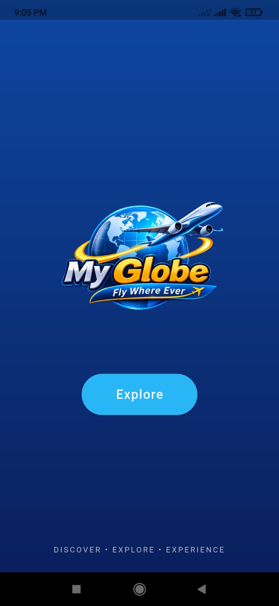
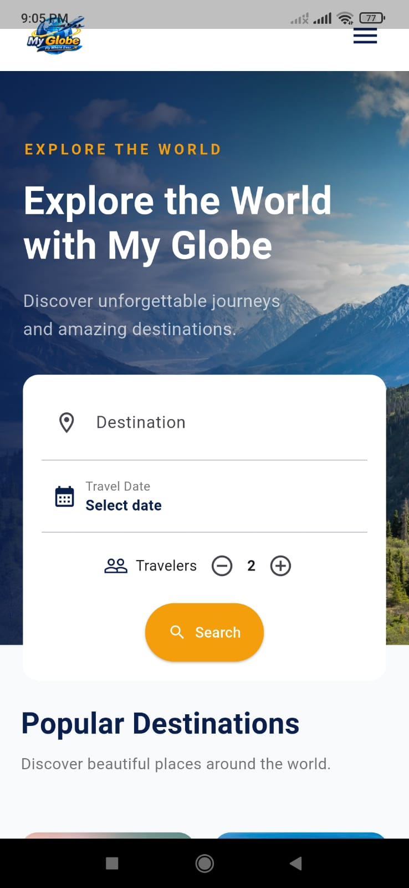
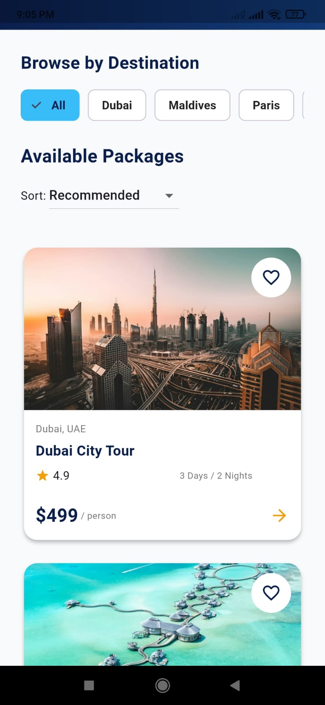
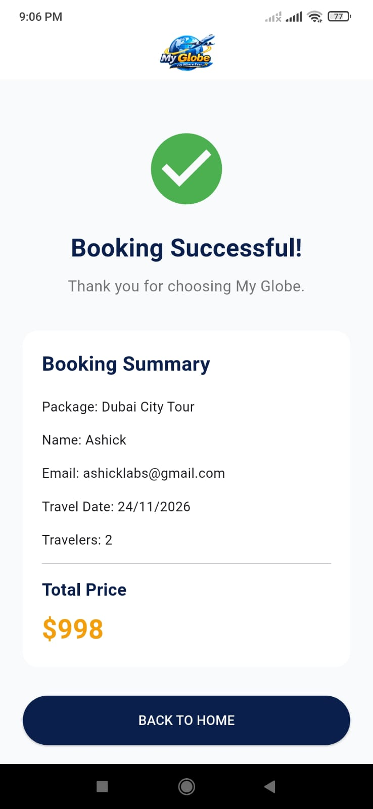

# 🌍 MY GLOBE – Fly Where Ever ✈️

A Flutter-based Travel Booking Application designed to make exploring destinations and browsing travel packages simple and convenient.

## 📱 About the Project

MY GLOBE is a travel application built using Flutter and Dart. It provides a user-friendly interface to explore destinations, browse travel packages, and manage booking details.

## ✨ Features

- 🚀 Splash Screen
- 🏠 Home Screen
- 🌍 Explore Travel Destinations
- 📦 Browse All Travel Packages
- 🔍 Package Details
- ❤️ Favorites
- 📝 Booking Form
- ✅ Booking Confirmation
- 📋 My Bookings
- ℹ️ About Us
- 📞 Contact Screen
- 🛠️ Admin Dashboard
- ## 📱 App Screenshots

### Splash Screen


### Home Screen


### Travel Packages


### Booking Screen


## 🛠️ Technologies Used

- Flutter
- Dart
- Visual Studio Code
- Android Studio

## 📂 Project Structure

```text
My-Globe/
├── android/
├── assets/
│   └── images/
├── ios/
├── lib/
├── linux/
├── macos/
├── test/
├── web/
├── windows/
├── pubspec.yaml
└── README.md
```

## 🚀 Getting Started

### Prerequisites

- Flutter SDK
- Dart SDK
- Visual Studio Code or Android Studio

### Installation

1. Clone the repository:

```bash
git clone https://github.com/Ashick3200/My-Globe.git
```

2. Open the project folder:

```bash
cd My-Globe
```

3. Install dependencies:

```bash
flutter pub get
```

4. Run the application:

```bash
flutter run
```

### Build Android APK

```bash
flutter build apk --release
```

## 👨‍💻 Developer

**Ashick3200**

GitHub: [Ashick3200](https://github.com/Ashick3200)

## 📌 Project Status

Flutter travel application – Development project.

---

**MY GLOBE – Fly Where Ever! 🌍✈️**
